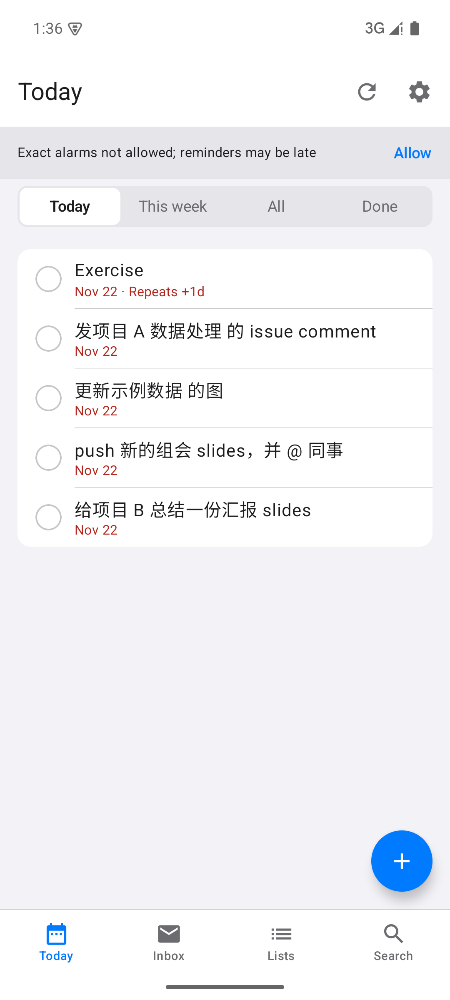

# orgtd

[](https://github.com/Grant-S-Z/orgtd/actions/workflows/ci.yml)
[](https://github.com/Grant-S-Z/orgtd/releases)
[](LICENSE)


[中文](README.zh-CN.md) · **English**

An Android GTD client that uses plain-text org files as its only data source. Keep your `~/org` in Emacs, then use a TickTick-style interface on your phone to see today's tasks, tick them off, or jot down a new one — everything is written back to the same `.org` file.



## Why

Anyone managing tasks in Emacs has hit this: you are away from your laptop, and all you need is to glance at today, tick one item off, or capture a thought. The alternatives are opening the laptop or SSH-ing from the phone.

orgtd is not another task database. It reads and writes your existing `gtd.org` directly, and **preserves every untouched line byte-for-byte** on write-back, so opening the file in Emacs shows no spurious diff.

## Features

**Tasks**

- Four views: Today / This week / All / Done, with overdue highlighting and nested subtasks.
- Create, rename, reschedule (date and time), set priority, delete with undo.
- Swipe left to complete, swipe right to postpone by one day; the detail sheet offers 1 / 3 / 7-day postpone.
- The detail sheet shows the body text under the heading, preserving line breaks.
- Multi-level headings become subtasks. When every direct subtask is done, the parent task is completed automatically; reopening a subtask reopens the parent.

**Organization**

- Inbox and lists (a top-level org heading is a list; open one to see its tasks).
- Create, rename, reorder, and soft-delete lists.
- Search covers titles, body text, and tags.
- Completed tasks can be archived: an `:ARCHIVED_AT:` property hides them from Done; switch to Archived to restore them.

**Sync and offline**

- Connect directly to Nutstore (坚果云) over WebDAV, or grant the app a local folder kept in sync by tools such as FolderSync.
- A background job pulls the remote file and reschedules reminders every 15 minutes.
- When offline, the last synced copy is shown read-only: writes are blocked with a clear message instead of silently lost.
- Before each write the remote file is re-read and the local change is applied on top of the latest content (matched by `:ID:`), never a blind whole-file overwrite.

**Reminders**

- Exact reminders for `SCHEDULED` / `DEADLINE` entries that have a time, with "Complete" and "Postpone to tomorrow" actions in the notification.
- Optional 9:00 reminder for date-only tasks.

**Interface**

- Chinese / English, following the system language or set per app; switches take effect immediately.
- Two visual styles: Apple (default, iOS-like) and Material 3 (five colour schemes plus dynamic colour).
- Light / dark / follow-system appearance.
- Settings → About checks GitHub Releases and can download and install an update in place (Android asks once for permission to install apps from orgtd, then shows its own install confirmation).

## Install

Download the latest `app-release.apk` from [Releases](https://github.com/Grant-S-Z/orgtd/releases).

If a debug build is already installed, uninstall it first — the two are signed with different keys and cannot overwrite each other. Your org files are not affected.

### Huawei / HarmonyOS

HarmonyOS 4.x ships an Android 12 compatibility layer and runs the APK as-is (HarmonyOS 5 / NEXT drops Android app support). Two system settings matter:

1. **Pure Mode**: turn off "Settings → System & updates → Pure Mode → Enhanced protection" before installing, and confirm the "unverified app" prompt.
2. **App launch management**: set orgtd to manual management and allow auto-launch and background activity, otherwise the system may kill reminder alarms.

## Setup

### Nutstore WebDAV (recommended)

1. Sign in to Nutstore in a browser → **Security → Add app password** to generate a dedicated password (not your login password).
2. In the app, open Settings → Storage → "Nutstore WebDAV" and fill in:
   - File URL: `https://dav.jianguoyun.com/dav/<your folder>/gtd.org`
   - Account: your Nutstore email
   - App password: the value from step 1
3. Tap "Save and connect".

The app password is encrypted with the Android Keystore. Each write re-reads the remote file first, so changes made on the other device are preserved.

### Start from scratch

If you do not have an org file yet, the first screen offers **"Start a new org file on this phone"**. The app creates `gtd.org` in its private storage with a small starter template — no folder picker, no Nutstore account, no Emacs required. You can switch to WebDAV or a local folder later in Settings, and use **Settings → Share org file** to export the current file through the system share sheet (send it to Nutstore, a file manager, or another device).

### Local folder

If you would rather not give the app a network password, sync the file to a normal folder with FolderSync, then grant orgtd that folder. The app only reads and writes `gtd.org` inside it.

> The Nutstore app's own offline folder cannot be used: it lives under `Android/data/nutstore.android/files/`, which Android 11+ blocks other apps from accessing.

### What gets written back to org

| In the app | In the org file |
|---|---|
| List | Top-level heading `* Work` |
| Task | Sub-heading `** TODO Write report` |
| Done / archived | `DONE` + `CLOSED:` / property `:ARCHIVED_AT:` |
| Scheduled / due | `SCHEDULED:` / `DEADLINE:` |
| Repeat | `+1w` (calendar) or `.+3d` (from completion) |
| Priority | `[#A]` / `[#B]` / `[#C]` |
| Notes | Body text under the heading |

Only `TODO` and `DONE` are written as states — these are Emacs defaults, so no extra `#+TODO:` declaration is needed.

## Development

Modules:

- `:orgmode` — pure-JVM org parser and writer, no Android dependencies, testable on its own.
- `:app` — Jetpack Compose UI and storage layer.

Build (macOS / Apple Silicon, JDK 21, Android SDK 37.1):

```bash
./scripts/setup-android.sh                              # one-time JDK + SDK setup
./gradlew :orgmode:test :app:assembleDebug              # tests + debug APK
adb install -r app/build/outputs/apk/debug/app-debug.apk
```

Prefer a desktop preview over installing on a phone:

```bash
./scripts/dev-preview.sh
```

It starts a windowed AVD, installs the latest build, and pushes a sample file; folder permission has to be granted manually once.

Toolchain: AGP 9.5.2 / Gradle 9.9.2 / Kotlin 2.4.21 / compileSdk 37.1 / Compose BOM 2026.11.01.

## Docs

- [Design document](docs/plans/2026-11-24-orgtd-design.md): data mapping, parsing strategy, sync and conflict handling, milestones and decisions.
- [Changelog](CHANGELOG.md)
- [Releasing](RELEASING.md): signing, CI, versioning rules.

## License

GPL-3.0-or-later, see [LICENSE](LICENSE). This matches Orgzly, the other major Android org client (also GPLv3), so reference implementations can be studied without licence conflicts.
