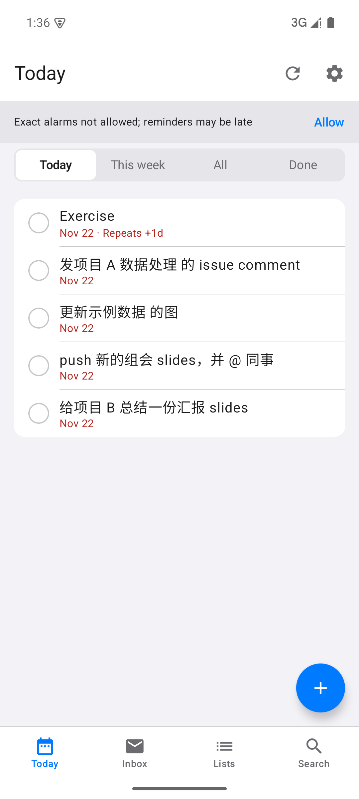

# orgtd

[](https://github.com/Grant-S-Z/orgtd/actions/workflows/ci.yml)
[](https://github.com/Grant-S-Z/orgtd/releases)
[](LICENSE)


**中文** · [English](README.md)

把 org 文件当数据源的 Android GTD 客户端。在 Emacs 里管 `~/org`，在手机上用滴答清单式的界面看今天、勾任务、临时加一条——写回去的还是同一个纯文本 `.org` 文件。



## 它解决什么

在 Mac 上用 Emacs 管理任务的人都遇到过：出门在外想看一眼今天要做什么、勾掉一条、随手记一件事，只能开电脑或者用手机 SSH。

orgtd 不做第二套任务系统，也不复制一份数据到云端数据库：它直接读写你原来的 `gtd.org`，写回时**保留未改动行的原始字节**，所以回到 Emacs 打开文件看不到多余 diff。

## 功能

**任务**

- 今天 / 本周 / 全部 / 已完成四档视图，逾期标红，子任务缩进并计数。
- 新建、改标题、改日期与时刻、改优先级、删除（可撤销）。
- 左滑完成、右滑推迟一天；详情面板可推迟 1 / 3 / 7 天。
- 详情面板显示标题下的正文备注，保留原有换行。
- 多级标题即子任务：直接子任务全部完成时父任务自动完成；重新打开子任务会把父任务改回 TODO。

**组织**

- Inbox、清单（org 的顶层 headline 就是清单，点进去看该清单下的任务）。
- 清单支持新建、重命名、上下移动、软删除。
- 搜索覆盖标题、正文和标签。
- 已完成任务可归档：写入 `:ARCHIVED_AT:`，从「已完成」隐藏，切到「已归档」可恢复。

**同步与离线**

- 直连坚果云 WebDAV，读写远端 `gtd.org`；也支持授权本地目录（配合 FolderSync 等工具）。
- 后台每 15 分钟拉取一次远端内容并重排提醒。
- 断网时显示上次同步的副本，写操作会被拦住并提示，不会静默丢改动。
- 每次写入前重新读取远端，把本地改动叠加在最新内容上（按 `:ID:` 定位），不做整文件覆盖。

**提醒**

- 带时刻的 `SCHEDULED` / `DEADLINE` 精确提醒，通知上可直接「完成」或「推迟到明天」。
- 可选让只有日期没有时刻的任务在 9:00 提醒。

**界面**

- 中文 / English 双语，可跟随系统或单独指定，切换即时生效。
- 两套界面风格：Apple（默认，iOS 观感）与 Material 3（含五套配色 + 动态取色）。
- 浅色 / 深色 / 跟随系统。
- 设置 → 关于可以检查 GitHub 上的新版本，并在 App 内直接下载安装（首次需要允许本应用安装应用，之后由系统的安装确认弹窗把守）。

## 安装

从 [Releases](https://github.com/Grant-S-Z/orgtd/releases) 下载最新的 `app-release.apk` 安装。

如果手机上装过 debug 包，需要先卸载——两者签名不同，不能覆盖安装。 org 文件本身不受影响。

### 华为 / HarmonyOS

HarmonyOS 4.x 的 Android 兼容层是 Android 12，可直接装 APK（5.0 / NEXT 不再兼容）。两步系统设置会影响使用：

1. **纯净模式**：关闭「设置 → 系统和更新 → 纯净模式 → 增强防护」，安装时勾选「已了解此应用未经检测」。
2. **应用启动管理**：把 orgtd 设为手动管理，允许自启动和后台活动，否则提醒可能被系统清掉。

## 配置

### 坚果云 WebDAV（推荐）

1. 浏览器登录坚果云 → **安全选项 → 添加应用密码**，生成一个专用密码（不是登录密码）。
2. App 右上角齿轮 → 存储位置选「坚果云 WebDAV」，填：
   - 文件地址：`https://dav.jianguoyun.com/dav/<你的目录>/gtd.org`
   - 账号：坚果云注册邮箱
   - 应用密码：第 1 步生成的值
3. 点「保存并连接」。

密码用 Android Keystore 加密存储。写入前会重新读取远端内容再叠加改动，避免覆盖另一端的修改。

### 从零开始

如果还没有任何 org 文件，首次打开的页面可以直接点「直接在手机上新建一个 org 文件」：App 会在自己的私有目录里创建 `gtd.org`，带一个很小的初始模板——不用选文件夹、不用坚果云账号、也不用先有 Emacs。之后可以随时在设置里切换到 WebDAV 或本地目录；设置里的「分享 org 文件」可以把当前文件通过系统分享发到坚果云、文件管理器或其他设备。

### 本地目录

不想让 App 持有网络密码时，可以用 FolderSync 之类工具把文件同步到手机普通目录，再让 App 授权该目录。App 只读写这个目录里的 `gtd.org`。

> 不能用坚果云 App 自己的离线目录：它在 `Android/data/nutstore.android/files/` 下，Android 11+ 禁止其他应用访问。

### 写回 org 的约定

| 手机上的东西 | 写回 org 的样子 |
|---|---|
| 清单 | 顶层标题 `* 工作` |
| 任务 | 子标题 `** TODO 写周报` |
| 完成 / 归档 | `DONE` + `CLOSED:` / 属性 `:ARCHIVED_AT:` |
| 日期 / 截止 | `SCHEDULED:` / `DEADLINE:` |
| 重复 | `+1w`（按日历）或 `.+3d`（按完成后） |
| 优先级 | `[#A]` / `[#B]` / `[#C]` |
| 备注 | 标题下的正文 |

状态只写 `TODO` 和 `DONE`，这是 Emacs 的默认关键字，因此不需要额外的 `#+TODO:` 声明。

## 开发

模块：

- `:orgmode` — 纯 JVM 的 org 解析与写回库，不依赖 Android，可单独测试。
- `:app` — Jetpack Compose 界面与存储层。

构建（macOS / Apple Silicon，JDK 21，Android SDK 37.1）：

```bash
./scripts/setup-android.sh                              # 一次性配置 JDK 与 SDK
./gradlew :orgmode:test :app:assembleDebug              # 测试 + debug 包
adb install -r app/build/outputs/apk/debug/app-debug.apk
```

不想装手机时用模拟器窗口预览：

```bash
./scripts/dev-preview.sh
```

它会启动带窗口的 AVD、装上最新包并推入示例文件；目录授权第一次需要手动点一次。

构建底座：AGP 9.5.2 / Gradle 9.9.2 / Kotlin 2.4.21 / compileSdk 37.1 / Compose BOM 2026.11.01。

## 文档

- [设计文档](docs/plans/2026-11-24-orgtd-design.md)：数据映射、解析策略、同步与冲突处理、里程碑与决策记录。
- [更新日志](CHANGELOG.md)
- [发布流程](RELEASING.md)：签名、CI、版本号规则。

## 许可

GPL-3.0-or-later，见 [LICENSE](LICENSE)。选它是因为 org 生态里的 Android 客户端（Orgzly）同为 GPLv3，避免将来参考实现时产生许可冲突。
